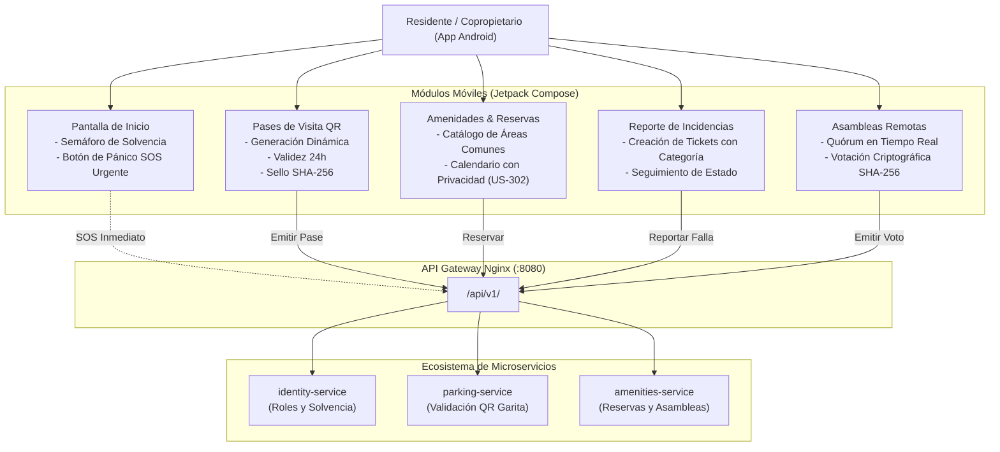

# Sistema de Gestión Residencial — Aplicación Móvil para Residentes (Fase 3)

## 1. Visión General

La **Fase 3** entrega la aplicación móvil nativa para residentes de **Residencial Las Brisas**, desarrollada en **Android Kotlin** utilizando el kit de interfaz declarativa moderno **Jetpack Compose**, siguiendo los patrones de **Clean Architecture** y **MVVM (Model-View-ViewModel)** con reactividad basada en **Corrutinas y StateFlow**.

---

## 2. Diagrama de Interacción Móvil y Servicios (Mermaid)



---

## 3. Características y Cumplimiento de Historias de Usuario

### 3.1. Semáforo de Solvencia y Perfil Residencial (US-101, US-102)
- Visualización destacada del estado financiero del inmueble (`SOLVENTE` en verde vs `EN MORA` en rojo).
- Consulta del importe de cuota mensual y saldo acumulado.

### 3.2. Pases Rápidos de Visita con QR Dinámico (US-601)
- Generación de pases temporales válidos por 24 horas.
- Payload cifrado y firmado con algoritmo criptográfico **SHA-256**:
  `RESIPASS::<uuid>|<casa>|<placa>|<visitante>|<expiracion>::HASH::<sha256>`
- Visor de código QR en pantalla con placa vehicular destacada y opción de compartir.

### 3.3. Botón de Pánico SOS para Emergencias
- Botón circular prominente en la pantalla de inicio con diálogo de confirmación para prevenir activaciones accidentales.
- Despacho inmediato de alerta de emergencia hacia la pantalla de control de garita y junta directiva.

### 3.4. Amenidades y Reservas con Privacidad (US-301, US-302)
- Catálogo con Salón Social, Churrasqueras y Cancha Polideportiva.
- Consulta de disponibilidad y solicitud de reserva protegiendo los datos personales de terceros conforme al requisito **US-302**.

### 3.5. Reporte de Incidencias y Mantenimiento (US-501, US-502)
- Formulario para registrar reportes de averías (Fontanería, Iluminación, Piscina, Áreas Verdes, Seguridad).
- Indicador de ciclo de vida (`OPEN` &rarr; `IN_PROGRESS` &rarr; `RESOLVED`).

### 3.6. Asambleas y Votación Electrónica Remota (US-401, US-402, US-403)
- Termómetro visual de quórum con umbral del 50%.
- Voto electrónico ponderado (`A_FAVOR`, `EN_CONTRA`, `ABSTENCION`) con generación de hash SHA-256 inmutable de auditoría.

---

## 4. Estructura del Proyecto Android (`mobile/`)

```
mobile/
├── build.gradle.kts (Raíz)
├── settings.gradle.kts
├── gradle.properties
├── gradle/wrapper/gradle-wrapper.properties
└── app/
    ├── build.gradle.kts
    └── src/
        ├── main/
        │   ├── AndroidManifest.xml
        │   ├── res/values/
        │   │   ├── colors.xml
        │   │   ├── strings.xml
        │   │   └── themes.xml
        │   └── java/com/residencial/app/
        │       ├── MainActivity.kt               # Scaffold, BottomBar, navegación
        │       ├── ResidencialApp.kt             # Application class
        │       ├── data/
        │       │   ├── model/Models.kt           # Modelos de datos
        │       │   └── repository/ResidentRepository.kt # Estado y acciones
        │       └── ui/
        │           ├── navigation/Navigation.kt  # Enums y rutas
        │           ├── theme/                    # Paleta de colores e interfaz oscura
        │           └── screens/
        │               ├── home/HomeScreen.kt
        │               ├── passes/PassesScreen.kt
        │               ├── amenities/AmenitiesScreen.kt
        │               ├── tickets/TicketsScreen.kt
        │               └── assembly/AssemblyScreen.kt
        └── test/java/com/residencial/app/
            ├── QrPassGeneratorTest.kt            # Pruebas unitarias de tokens QR y SHA-256
            └── ResidentRepositoryTest.kt         # Pruebas unitarias de flujos de negocio
```
