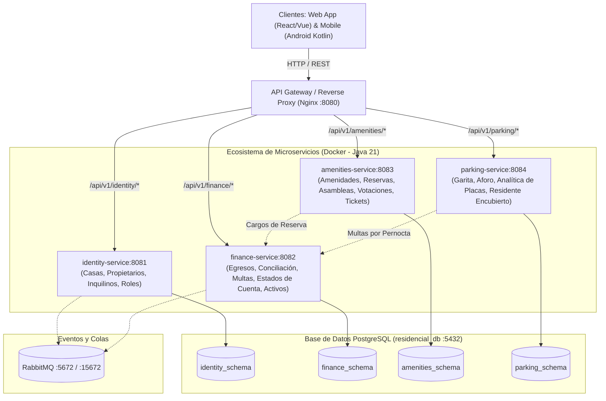

# Sistema de Gestión Residencial — Plataforma Integral de Microservicios DDD

[](https://adoptium.net/)
[](https://spring.io/projects/spring-boot)
[](https://www.postgresql.org/)
[](https://www.docker.com/)
[](docs/01-architecture-design.md)

Plataforma backend modular orientada al **Diseño Guiado por el Dominio (DDD)** y microservicios autónomos, construida con estándares empresariales para la administración comunitaria, financiera, operativa y de seguridad en complejos residenciales.

---

## 1. Arquitectura del Sistema (C4 Containers)

El sistema está orquestado mediante **Docker Compose**, compuesto por **4 Microservicios Autónomos**, **1 API Gateway Centralizado (Nginx)**, **PostgreSQL con esquemas aislados por bounded context** y **RabbitMQ**:



---

## 2. Cobertura del Backlog (100% Implementado)

| Épica | Historias de Usuario | Microservicio | Esquema BD | Puerto | Descripción |
| :--- | :--- | :---: | :---: | :---: | :--- |
| **Épica 1: Identidad y Comunidad** | US-101, US-102 | `identity-service` | `identity_schema` | `8081` | Registro de casas, invitación/activación de propietarios y delegación restringida de inquilinos. |
| **Épica 2: Finanzas y Mobiliario** | US-201, US-202, US-203, US-204, US-205 | `finance-service` | `finance_schema` | `8082` | Registro de facturas, conciliación bancaria desatendida (Excel), multas, estado de cuenta e inventario de activos. |
| **Épica 3: Amenidades y Reservas** | US-301, US-302 | `amenities-service` | `amenities_schema` | `8083` | Catálogo de amenidades, calendario de privacidad (solo "Reservado"), validación de solvencia y cargo financiero. |
| **Épica 4: Asambleas y Votaciones** | US-401, US-402, US-403 | `amenities-service` | `amenities_schema` | `8083` | Convocatoria, pase de lista digital, cálculo de quórum ($\ge$ 50%), voto seguro exclusivo para propietarios (1 voto/casa con hash SHA-256) y veredicto automático. |
| **Épica 5: Tickets de Mantenimiento** | US-501, US-502 | `amenities-service` | `amenities_schema` | `8083` | Reporte de incidencias con fotografías y folio único (`OPEN`), asignación de técnicos (`IN_PROGRESS`) y notificaciones al residente. |
| **Épica 6: Parqueo y Garita** | US-601, US-602, US-603 | `parking-service` | `parking_schema` | `8084` | Control operativo en garita con asignación automática de cajón (`P-01` a `P-20`), motor de analítica de pernoctas para detectar "Residente Encubierto" y multas automáticas con bitácora. |

---

## 3. Puesta en Marcha Local con Docker Compose

### Requisitos Previos:
* Docker Engine 24+ y Docker Compose v2+
* Puertos libres en el host: `8080` (Gateway), `5432` (PostgreSQL), `5672` / `15672` (RabbitMQ), y `8081` a `8084` (Microservicios).

### 1. Iniciar toda la infraestructura y microservicios:
```bash
docker compose up -d --build
```

El script [`docker/postgres/init-all.sql`](docker/postgres/init-all.sql) se ejecutará automáticamente en la inicialización de PostgreSQL, aplicando las extensiones UUID, los 4 esquemas y las 9 migraciones secuenciales (`V1` a `V9`) con sus datos semilla (incluyendo los 20 cajones de parqueo de visitas).

### 2. Verificar el estado del API Gateway:
```bash
curl http://localhost:8080/health
```
**Respuesta:**
```json
{
  "status": "UP",
  "gateway": "Nginx Reverse Proxy",
  "services": ["identity", "finance", "amenities", "parking"]
}
```

---

## 4. Matriz de Rutas del API Gateway (`http://localhost:8080`)

| Módulo / Contexto | Ruta Base en Gateway | Microservicio Destino | Principales Operaciones |
| :--- | :--- | :---: | :--- |
| **Identidad & Casas** | `/api/v1/identity/*` | `identity-service:8081` | Alta de casas, invitaciones y activación de usuarios (`OWNER`, `TENANT`). |
| **Finanzas & Activos** | `/api/v1/finance/*` | `finance-service:8082` | Facturas de egresos, conciliación bancaria masiva, multas, saldo de cuenta y activos. |
| **Amenidades & Reservas** | `/api/v1/amenities/` | `amenities-service:8083` | Configuración de amenidades, consulta de calendario con privacidad y solicitudes de reserva. |
| **Asambleas & Quórum** | `/api/v1/amenities/assemblies/*` | `amenities-service:8083` | Convocatoria, registro de asistencia (pase de lista) y cálculo de quórum legal. |
| **Votaciones Digitales** | `/api/v1/amenities/motions/*` | `amenities-service:8083` | Apertura de mociones, emisión de voto seguro (1 voto/casa con hash SHA-256) y escrutinio. |
| **Tickets de Mantenimiento** | `/api/v1/amenities/tickets/*` | `amenities-service:8083` | Reporte con foto, seguimiento de técnicos, bitácora y notificaciones de avance. |
| **Garita & Parqueo** | `/api/v1/parking/entries/*` | `parking-service:8084` | Ingreso y salida de visitantes, asignación y liberación de cajones (`P-01` a `P-20`). |
| **Analítica de Placas** | `/api/v1/parking/analytics/*` | `parking-service:8084` | Reporte de sospecha de "Residente Encubierto" ($\ge$ 3 pernoctas nocturnas). |
| **Multas de Parqueo** | `/api/v1/parking/fines/*` | `parking-service:8084` | Aplicación de sanciones por abuso de parqueo con evidencia y cargo a finanzas. |

---

## 5. Planes de Prueba y Documentación de QA

Todos los planes de prueba, matrices de aceptación (Gherkin), payloads de prueba y consultas SQL de verificación se encuentran organizados en la carpeta [`docs/qa/`](docs/qa/):

1. [docs/qa/01-us-101-102-test-plan.md](docs/qa/01-us-101-102-test-plan.md) — Onboarding, Casas y Roles.
2. [docs/qa/02-us-201-test-plan.md](docs/qa/02-us-201-test-plan.md) — Facturas y Egresos Operativos.
3. [docs/qa/03-us-202-test-plan.md](docs/qa/03-us-202-test-plan.md) — Conciliación Bancaria Masiva por Excel.
4. [docs/qa/04-us-203-test-plan.md](docs/qa/04-us-203-test-plan.md) — Catálogo y Aplicación de Multas.
5. [docs/qa/05-us-204-test-plan.md](docs/qa/05-us-204-test-plan.md) — Estado de Cuenta Personal y Semáforo de Solvencia.
6. [docs/qa/06-us-205-test-plan.md](docs/qa/06-us-205-test-plan.md) — Inventario y Auditoría de Activos Fijos.
7. [docs/qa/07-us-301-302-test-plan.md](docs/qa/07-us-301-302-test-plan.md) — Amenidades y Calendario de Reservas con Privacidad.
8. [docs/qa/08-us-401-403-test-plan.md](docs/qa/08-us-401-403-test-plan.md) — Asambleas, Quórum y Votaciones Seguras (Hash SHA-256).
9. [docs/qa/09-us-501-502-test-plan.md](docs/qa/09-us-501-502-test-plan.md) — Tickets de Incidencia y Notificaciones de Avance.
10. [docs/qa/10-us-601-603-test-plan.md](docs/qa/10-us-601-603-test-plan.md) — Parqueo de Visitas, Garita y Analítica de Placas.

---

## 6. Ejecución de Pruebas Unitarias

Para ejecutar las suites de pruebas de los microservicios sin requerir Java instalado localmente:

```bash
# Ejemplo: Pruebas unitarias de parking-service
docker run --rm -v ~/.m2:/root/.m2 -v $(pwd)/services/parking-service:/app -w /app maven:3.9.6-eclipse-temurin-21 mvn test

# Ejemplo: Pruebas unitarias de amenities-service
docker run --rm -v ~/.m2:/root/.m2 -v $(pwd)/services/amenities-service:/app -w /app maven:3.9.6-eclipse-temurin-21 mvn test
```

* **Tasa de Aprobación de Pruebas:** 100% de éxito en más de 130 casos unitarios.

---

## 7. Portal Web Administrativo y de Garita (React + TypeScript + Tailwind CSS)

Ubicado en el directorio [`web/`](web/), esta aplicación web moderna (SPA) desarrollada con **React 18**, **TypeScript**, **Tailwind CSS**, sistema de alertas reactivas con **`react-hot-toast`**, **soporte para Tema Claro y Tema Oscuro** y empaquetada con **Vite**, provee una interfaz unificada protegida con **Autenticación Obligatoria y Control de Acceso Basado en Roles (RBAC)**:

### Credenciales de Demostración del Sistema

| Perfil | Usuario / Correo | Contraseña | Rol | Acceso y Restricciones |
| :--- | :--- | :--- | :--- | :--- |
| **Guardia de Garita** | `guardia@lasbrisas.gt` | `Garita2026!` | `GUARD` | **Exclusivo Tablet Garita (US-601).** Oculta y bloquea menús de Junta Directiva para prevenir manipulación o data no autorizada. |
| **Administrador** | `admin@lasbrisas.gt` | `Admin2026!` | `ADMIN` | Acceso completo (Seguridad, Asambleas, Amenidades, Tickets, Finanzas). |
| **Presidente Junta** | `junta@lasbrisas.gt` | `Junta2026!` | `BOARD` | Acceso completo a gobernanza y asambleas. |

### Modos Operativos Protegidos por Rol

1. **Modo Garita (Tablet Touch - US-601):**
   - **Cuadrícula Visual Interactiva de 20 Espacios (`P-01` a `P-20`):** Indicadores en tiempo real de disponibilidad (Verde: Disponible, Rojo: Ocupado).
   - **Check-in Rápido de Vehículos de Visita:** Modal táctil para registrar placa, casa de destino, nombre del visitante y DPI.
   - **Check-out Inmediato:** Botón de 1-clic ("Marcar Salida") directo en la celda del espacio o en la tabla detallada.
   - **Medidores de Aforo:** Conteo en vivo de capacidad, vehículos estacionados y porcentaje de ocupación.

2. **Modo Junta Directiva y Administración:**
   - **Seguridad & Parqueos (US-602, US-603):** Tabla analítica de vehículos detectados como *Residentes Encubiertos* ($\ge 3$ pernoctaciones nocturnas), visor forense de historial de ingresos y botón directo para aplicar multas vinculadas a Finanzas (Q. 250.00).
   - **Asambleas & Quórum Legal (US-401, US-402, US-403):** Termómetro interactivo de quórum con umbral legal del 50%, pase de lista digital de copropietarios, apertura y cierre de mociones, y escrutinio automático sellado con hash SHA-256 inmutable.
   - **Amenidades & Calendario Protegido (US-301, US-302):** Catálogo de áreas comunes (Salón Social, Churrasqueras, Cancha Sintética) y calendario con filtro estricto de privacidad (sólo muestra estados "Disponible" o "Reservado" sin exponer datos personales).
   - **Mantenimiento & Tickets (US-501, US-502):** Tablero de incidencias por estado (`OPEN`, `IN_PROGRESS`, `RESOLVED`, `CLOSED`), selector de prioridades, registro de fallas y asignación de técnicos con bitácora de auditoría.
   - **Finanzas & Activos Fijos (US-201, US-202, US-203, US-205):** Consulta de facturas con enlace a soporte digital, simulador de conciliación bancaria automática vía Excel (.xlsx/.csv), e inventario patrimonial valorizado.

### Ejecución Local del Portal Web

```bash
# Desarrollo con Hot Reload (puerto 3000)
cd web
npm install
npm run dev

# Suite de pruebas unitarias (23 tests pasando)
npm test

# Compilación y verificación estática de tipos
npm run build

# O vía Docker Compose
docker compose up web -d
```

---

## 8. Aplicación Móvil para Residentes (Android Kotlin + Jetpack Compose)

Ubicada en el directorio [`mobile/`](mobile/), la aplicación móvil para residentes de **Residencial Las Brisas** provee las herramientas esenciales del día a día para los copropietarios:

### Módulos Móviles

1. **Pantalla de Inicio & Semáforo de Solvencia:**
   - Estado de cuenta y solvencia en tiempo real (`SOLVENTE` vs `EN MORA`).
   - Botón de Pánico (SOS) prominente con diálogo de confirmación para emergencias médicas y de seguridad.
2. **Pases de Visita QR (US-601):**
   - Generación de pases temporales de 24 horas con token criptográfico SHA-256.
   - Visor de código QR en pantalla para lectura directa en la Garita vehicular.
3. **Amenidades & Reservas (US-301, US-302):**
   - Catálogo de áreas comunes (Salón Social, Pérgola Churrasqueras, Cancha Polideportiva).
   - Consulta de disponibilidad protegida por privacidad y confirmación de reserva.
4. **Reporte de Fallas y Mantenimiento (US-501, US-502):**
   - Registro de incidencias técnicas con categorías y niveles de prioridad.
   - Monitoreo del avance de la reparación (`OPEN` &rarr; `IN_PROGRESS` &rarr; `RESOLVED`).
5. **Asambleas y Votación Electrónica Remota (US-401, US-402, US-403):**
   - Medidor de quórum legal en vivo (umbral 50%).
   - Votación ponderada remota en mociones abiertas con sellado criptográfico auditado SHA-256.

Para más detalles consulte [`MOBILE-APP.md`](MOBILE-APP.md).

