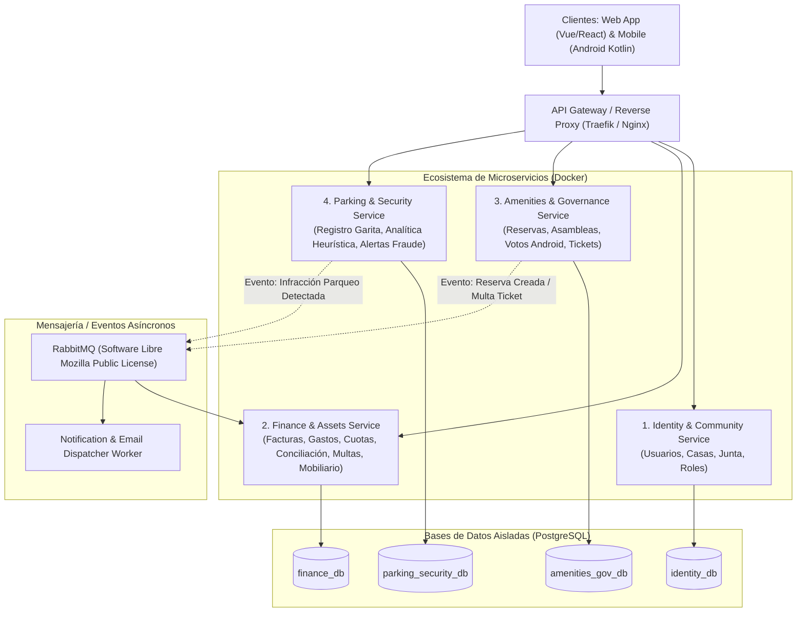
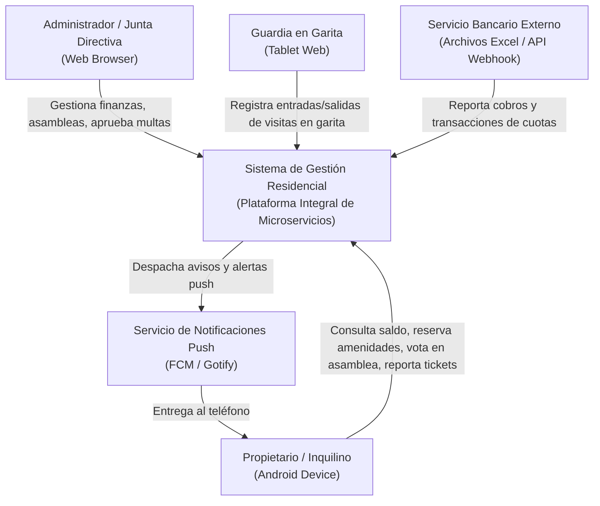
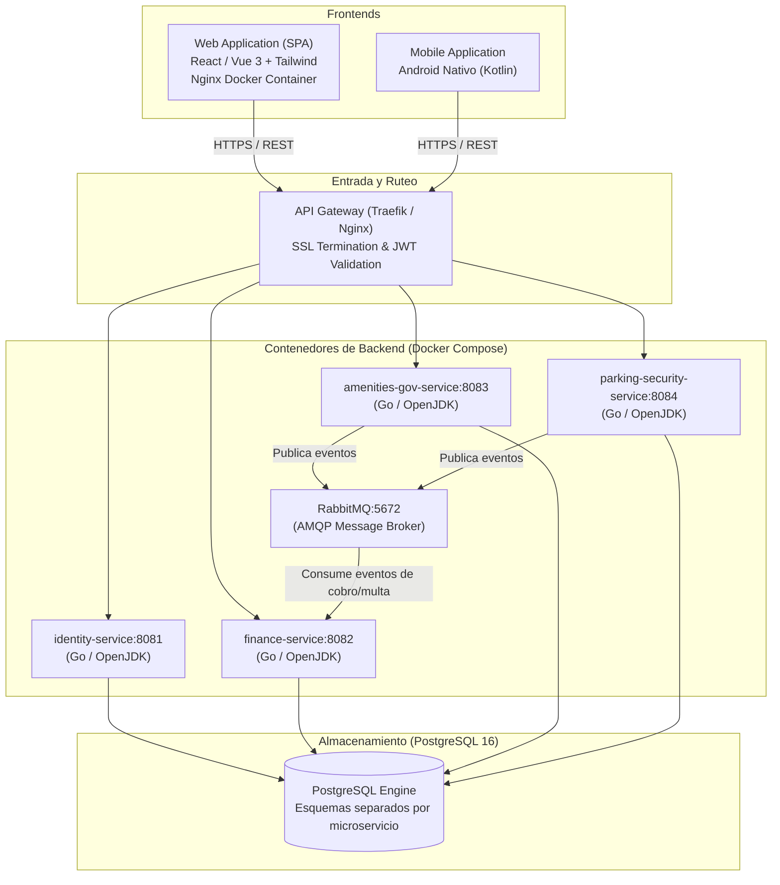
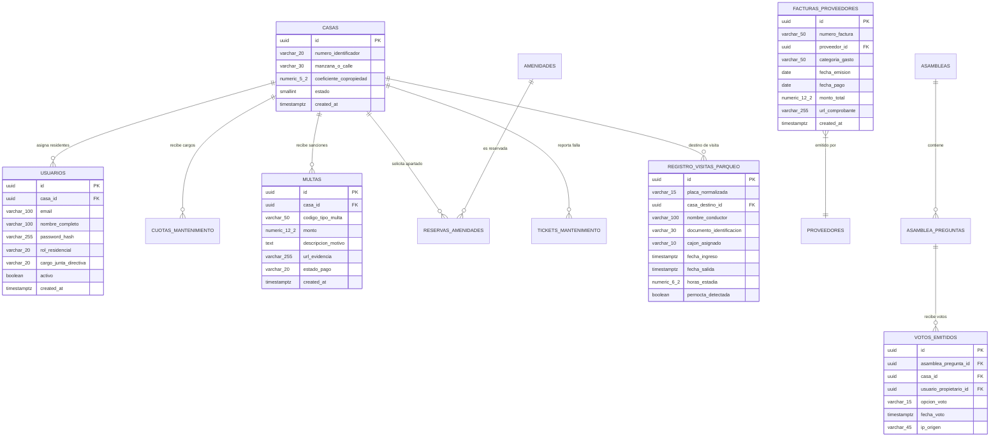

# Documento de Diseño de Arquitectura — Sistema de Gestión Residencial

## 1. Análisis y Selección del Stack Tecnológico (100% Software Libre / Sin Licenciamiento Propietario)

### 1.1 Evaluación de Lenguajes Backend (DDD + Microservicios + Cero Licencias)

| Criterio | Opción A: Go (Golang) | Opción B: Java con OpenJDK (Temurin) + Spring Boot / Quarkus | Opción C: TypeScript / Node (NestJS) |
| :--- | :--- | :--- | :--- |
| **Licencia** | BSD-style (100% libre y abierto) | GPLv2 + Classpath Exception (Eclipse Temurin / OpenJDK 21 LTS: 100% libre para uso comercial) | MIT (100% libre) |
| **Consumo de Memoria por Microservicio** | **Extremadamente bajo** (~25MB - 50MB RAM por contenedor) | Medio-Alto (~200MB - 350MB con Spring Boot; ~60MB con Quarkus nativo) | Medio (~90MB - 150MB) |
| **Alineación con DDD** | Excelente: paquetes idiomáticos por bounded contexts, sin dependencias mágicas ni frameworks invasivos. | Nativo: estándares históricos de DDD, repositories, agregados ricos con JPA/Hibernate o jOOQ. | Bueno: estructurado con NestJS, pero tipado estático no nominal. |
| **Curva de Aprendizaje y Estabilidad** | Lenguaje minimalista, compilado a binario estático, concurrencia nativa excelente (goroutines para analítica de placas y workers). | Muy maduro, tipado robusto, ecosistema enterprise gigantesco. | Rápido desarrollo inicial, pero mayor riesgo de sobrecarga en runtime. |

> **Recomendación de Arquitectura:** 
> - **Opción Primaria (Innovadora y Eficiente): Go (Golang 1.23+)**. Es el estándar moderno de microservicios en la nube y Docker: genera binarios estáticos sin máquinas virtuales, consume 5 veces menos memoria que Java, y su licencia BSD es totalmente permisiva. Además, para CQRS no requiere librerías propietarias como MediatR (se implementa con canales nativos o interfaces limpias estándar de ~30 líneas de código).
> - **Opción Alternativa (Clásica Empresarial): Java 21 LTS con Eclipse Temurin (OpenJDK) + Spring Boot 3.3**. Totalmente gratuito y libre de las licencias comerciales de Oracle, ideal para patrones DDD puristas.

---

## 2. Análisis Estratégico: Tenancy Inicial vs. Futuro

### 2.1 Decisión Técnica sobre `TenantId`
El usuario solicita evaluar si iniciar con una estructura limpia **sin `TenantId` en este momento**, agregándolo posteriormente mediante scripts de migración (`ALTER TABLE`) cuando el producto evolucione a SaaS multi-residencial.

**Análisis de Impacto y Viabilidad:**
1. **Viabilidad del `ALTER TABLE`:**
   - En PostgreSQL, agregar una columna nullable `tenant_id UUID NULL` o con valor por defecto es una operación instantánea (metadatos O(1) desde Postgres 11+).
   - Para el primer cliente, el esquema nace **simple, sin filtros globales forzados** ni condiciones `WHERE tenant_id = ...` en cada query.
2. **Buenas Prácticas para facilitar la migración futura:**
   - **Claves Primarias UUIDv7 / UUIDv4:** Todas las tablas principales usarán identificadores UUID en lugar de enteros autoincrementales (`SERIAL`). Esto garantiza que cuando se junten múltiples residenciales en el futuro, no existan colisiones de IDs primarios.
   - **Contratos de Dominio Aislados:** Cada microservicio manejará sus propios esquemas y tablas sin acoplamiento cruzado de base de datos.

> **Decisión Arquitectónica:** Iniciamos **Single-Tenant en datos**, modelando esquemas limpios en PostgreSQL con tipos UUID. El paso a Multi-Tenant se realizará en Fase 2 mediante un migration plan (`ALTER TABLE ... ADD COLUMN tenant_id`).

---

## 3. Descomposición de Microservicios (Bounded Contexts de DDD)

Para evitar la complejidad innecesaria de tener 15 microservicios diminutos, se definen **4 Microservicios de Negocio Cohesivos + 1 API Gateway**:

### 3.1 Responsabilidades de cada Microservicio
1. **`identity-community-service`:** Catálogo de Casas, Propietarios, Inquilinos, Junta Directiva, autenticación JWT desacoplada y auditoría básica de personas.
2. **`finance-assets-service`:** Registro de facturas (egresos), emisión de cuotas, motor de conciliación bancaria (parser Excel / API endpoint), balance mensual de caja, inventario de mobiliario y equipo.
3. **`amenities-governance-service`:** Calendario de amenidades y horarios, votaciones exclusivas Android (1 voto/casa), control de asistencia digital, tickets de mantenimiento y ciclo de vida.
4. **`parking-security-service`:** Formulario operativo de garita (tablet), cálculo de pernoctas/estadías, motor de analítica de comportamiento de placas y detección de residentes encubiertos.

---

## 4. Diagrama C4 — Nivel 1 & Nivel 2

### 4.1 C4 Nivel 1: Diagrama de Contexto de Sistema

### 4.2 C4 Nivel 2: Diagrama de Contenedores

---

## 5. Diseño y Optimización del Modelo Relacional (PostgreSQL)

Para optimizar al máximo el uso de almacenamiento y memoria en PostgreSQL:
- Se evita el uso de `TEXT` desmedido; se aplican longitudes acotadas (`VARCHAR(n)`).
- Identificadores en `UUID` (16 bytes compactos indexados eficientemente en B-Tree).
- Importes monetarios en `NUMERIC(12, 2)` (precisión exacta sin errores de redondeo de punto flotante).
- Flags y estados en `SMALLINT` o `VARCHAR(20)` legibles.

### 5.1 Diccionario de Datos / Esquema Relacional Principal

---

## 6. Alternativas de Notificaciones Push

El usuario solicitó alternativas a Firebase:

1. **Opción 1: Firebase Cloud Messaging (FCM)**
   - *Ventajas:* Nivel gratuito prácticamente ilimitado, estándar absoluto de la industria en Android nativo, consumo de batería optimizado en el sistema operativo Android gracias a los Google Play Services.
   - *Licencia/Costo:* Gratuito.
2. **Opción 2: OneSignal**
   - *Ventajas:* Panel web visual muy cómodo para redactar notificaciones, SDK para Android simple. Nivel gratuito amplio.
   - *Desventajas:* Por debajo utiliza FCM en dispositivos Android.
3. **Opción 3: Gotify / UnifiedPush (100% Self-Hosted & Open Source)**
   - *Ventajas:* Servidor propio en Docker (GPLv3), cero dependencia de Google o servicios en la nube privativos.
   - *Desventajas:* En Android requiere mantener un servicio de WebSocket en background o app cliente (UnifiedPush), lo que puede aumentar el consumo de batería si el dispositivo restringe procesos en segundo plano.

> **Recomendación:** Utilizar **FCM (Firebase Cloud Messaging)** en la capa de integración de la app Android por su eficiencia nativa de batería, pero con un adaptador en backend (`INotificationService`) que permita conmutar a una solución auto-hospedada si se desea.

---

## 7. Despliegue en Contenedores Docker (Agnóstico de Nube)

El diseño se empaqueta mediante **Docker y Docker Compose**:
- Puede ejecutarse localmente con `docker compose up -d`.
- Puede desplegarse sin cambios en **Azure** (Azure Container Apps / AKS), **AWS** (ECS Fargate / EKS) o en un VPS económico (DigitalOcean, Hetzner, Linode) con Docker Engine.
