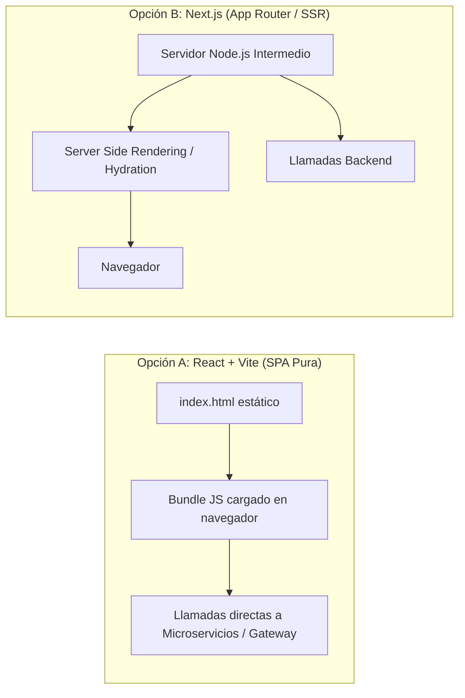
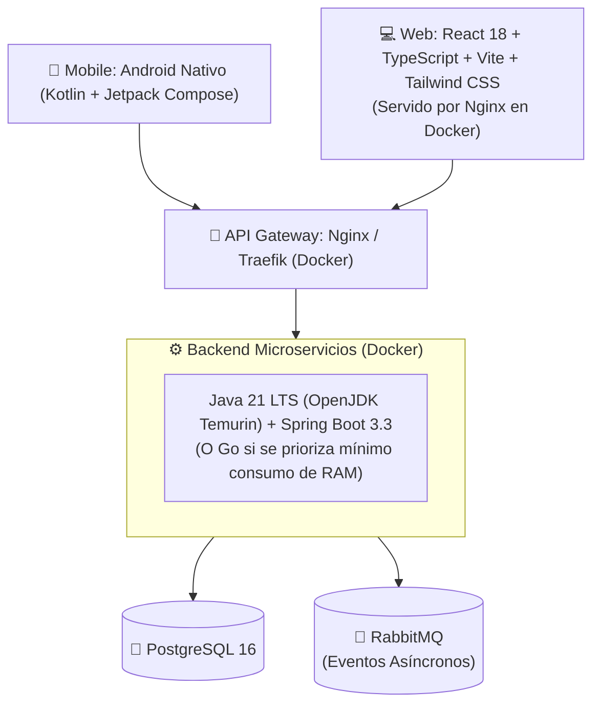

# Análisis Comparativo de Stack Tecnológico y Trade-Offs

## 1. Backend: Rust vs. Java (Spring Boot) vs. Go

Comparativa técnica de viabilidad para un **Sistema de Gestión Residencial orientado a DDD y Microservicios**:

```mermaid
quadrantChart
    title Velocidad de Desarrollo vs. Eficiencia de Recursos & Control
    x-axis Menor Eficiencia de Recursos --> Máxima Eficiencia (Memoria / CPU)
    y-axis Curva de Aprendizaje Larga / Lento Desarrollo --> Desarrollo Rápido & Ecosistema Maduro
    quadrant-1 "Ideal para Cloud Native & Balance"
    quadrant-2 "Desarrollo Rápido Enterprise"
    quadrant-3 "Sobrepeso / Riesgo"
    quadrant-4 "Máximo Rendimiento / Alta Fricción"
    "Java 21 + Spring Boot": [0.35, 0.85]
    "Go (Golang)": [0.85, 0.78]
    "Rust (Axum / Tokio)": [0.98, 0.28]
```

### 1.1 Tabla Comparativa Detallada

| Criterio | Rust (Axum / Actix-web + Tokio + SQLx) | Java 21 LTS (Eclipse Temurin + Spring Boot 3.3) | Go (Golang 1.23+) |
| :--- | :--- | :--- | :--- |
| **Licencia & Costo** | MIT / Apache-2.0 (100% libre) | GPLv2 + Classpath Exception (OpenJDK Temurin: 100% libre) | BSD-style (100% libre) |
| **Modelado DDD** | **Excepcional en el Sistema de Tipos:** Enums algebraicos (`Result`, `Option`), inmutabilidad por defecto, no existe el `null`. Representa estados de negocio imposibles en tiempo de compilación. | **Nativo y maduro en el Ecosistema:** Clases de dominio, JPA/Hibernate, Spring Data, Value Objects (Java Records). Muy intuitivo si vienes de C#/.NET. | Pragmático: tipos simples y structs, pero carece de enums algebraicos ricos. |
| **Curva de Aprendizaje & Fricción** | **Muy alta:** Borrow checker, lifetimes, manejo riguroso de memoria. Tareas comunes como parsear un Excel bancario o mapear DTOs con errores toman 3x más tiempo de desarrollo. | **Baja a moderada:** Extremadamente similar a C#/.NET (inyección de dependencias, anotaciones/decoradores, sintaxis casi idéntica). | **Muy baja:** Lenguaje minimalista que se domina en 1-2 semanas. |
| **Consumo de Memoria en Docker** | **Ultraligero:** ~15MB - 30MB RAM por microservicio. | **Moderado:** ~200MB - 350MB RAM por microservicio (mitigable a ~60MB con GraalVM Native Image). | **Muy ligero:** ~30MB - 50MB RAM por microservicio. |
| **Ecosistema para este Dominio** | Bueno en networking y APIs básicas; más limitado o manual en parsers de hojas de cálculo complejas (Excel/CSV) y reportes PDF. | **Gigantesco:** Librerías de software libre listas para producción para todo: Apache POI (Excel bancario), JasperReports/OpenPDF, Spring Security. | Muy bueno: librerías estándar concisas (`excelize` para Excel). |

### 1.2 Veredicto Backend:
* **Si el objetivo primario es aprender un lenguaje disruptivo de máximo rendimiento:** **Rust** es fascinante y te obligará a escribir código matemáticamente seguro. Sin embargo, para un sistema de gestión con CRUDs densos, reportes PDF y parsers de Excel, la fricción de desarrollo es alta.
* **Si buscas una transición natural desde .NET/C# con software libre y alta productividad:** **Java 21 con OpenJDK + Spring Boot 3** es la opción más sólida y segura: la curva de aprendizaje es casi nula (sintaxis y conceptos idénticos a C#), cero costo de licenciamiento, y el soporte para DDD es de clase mundial.

---

## 2. Frontend Web: React Puro (SPA con Vite) vs. Next.js

Para la aplicación Web de administración del residencial, comparamos ambas estrategias:



### 2.1 Comparativa de Arquitectura para un Dashboard Administrativo

| Factor de Decisión | React + Vite (SPA Pura) [Recomendado] | Next.js (SSR / React Framework) |
| :--- | :--- | :--- |
| **Propósito Principal** | Aplicaciones privadas tras login (Dashboards, Intranets, ERPs, Paneles Administrativos). | Sitios públicos, E-commerce, Marketing, Blogs que requieren **SEO e indexación en Google**. |
| **Despliegue en Docker** | **Ultraligero y Trivial:** Se compila a archivos estáticos (HTML/JS/CSS) y se sirve con un contenedor **Nginx** de ~20MB de RAM. Cero servidor de Node.js corriendo. | **Requiere servidor Node.js activo:** El contenedor Docker debe mantener un proceso Node.js en ejecución para renderizar páginas en el servidor (~100MB+ RAM). |
| **Complejidad de Autenticación** | Almacena el JWT en memoria o cookie estándar y consume directo el API Gateway. | Debe coordinar sesiones entre el servidor de Node.js y los microservicios backend (NextAuth o middleware de proxy). |
| **SEO / Indexación** | Cero SEO (no relevante: el panel del residencial requiere login obligatorio). | Excelente SEO (innecesario para este proyecto). |

> **Veredicto Frontend Web:** **React puro con TypeScript + Vite + Tailwind CSS**.
> Para un panel de administración residencial protegido por autenticación, **Next.js añade complejidad de servidor innecesaria** (requiere mantener un runtime de Node.js). Una SPA con Vite se empaqueta en un contenedor Nginx ultrarrápido y seguro.

---

## 3. Mobile: Android Nativo con Kotlin (Jetpack Compose)

La elección de **Android Nativo con Kotlin** es la decisión más acertada para los requerimientos del proyecto:

### Ventajas Técnicas para el Caso de Uso:
1. **Jetpack Compose:** Desarrollo moderno de interfaces declarativas reactivas (estilo React/Flutter pero con rendimiento nativo de 60/120 FPS).
2. **Notificaciones Push y Ciclo de Vida:** Control nativo absoluto de Firebase Cloud Messaging (FCM) sin capas intermedias que fallen al despertar la app en segundo plano.
3. **Seguridad en Votaciones:** Permite consultar de forma fidedigna datos del dispositivo y hardware para la auditoría del voto de asamblea (prevención de fraude e inmutabilidad).
4. **Room Database (Cache Offline):** Permite almacenar localmente comunicados y el último estado de cuenta descargado para consultarlos sin conexión a internet.

---

## 4. Stack Consolidado Propuesto


