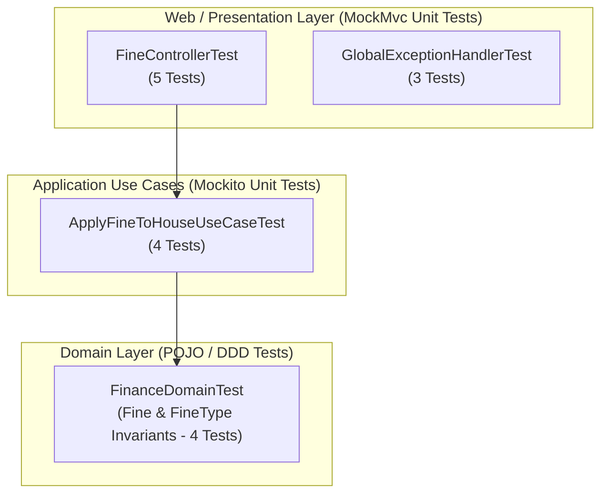

# QA Unit Testing Specification & Execution Report: US-203

## 1. Executive Summary & Objective
This report documents the automated unit testing suite executed for **US-203** (Fine Configuration Catalog & Fine Application to Houses with Custom or Default Amounts) in `finance-service` (Spring Boot 3.3.4, Java 21 LTS).

Following QA engineering standards, testing is isolated using **JUnit 5 Jupiter**, **Mockito**, and **Spring WebMvcTest / MockMvc**, validating:
- Application of fines using catalog default amounts (`customAmount = null`).
- Application of fines using custom amount overrides.
- Invariant enforcement: Rejection of non-existent or inactive fine types (`FineTypeNotFoundException`).
- Invariant enforcement: Rejection of non-positive custom amounts (`@DecimalMin("0.01")`).
- Domain lifecycle: Transition to `PAID` with payment date and `DISMISSED` with reason note.
- Standardized RFC 7807 Problem Details error responses for validation and domain rule violations.

Execution is 100% isolated without requiring Docker containers, external PostgreSQL instances, or network orchestration.

---

## 2. Unit Test Architecture & Component Layers



---

## 3. Test Cases & Acceptance Criteria Mapping

| Test ID | User Story | Component | Scenario / Objective | Expected Result | Status |
| :--- | :---: | :--- | :--- | :---: | :---: |
| **TC-203-01** | US-203 | `FineController` / `ApplyFineToHouseUseCase` | Apply fine using catalog default amount | **201 Created**, fine created with default amount Q300.00 and status `PENDING` | **PASSED** |
| **TC-203-02** | US-203 | `FineController` / `ApplyFineToHouseUseCase` | Apply fine using custom amount override | **201 Created**, fine created with custom amount Q750.00 and status `PENDING` | **PASSED** |
| **TC-203-03** | US-203 | `FineController` / `ApplyFineToHouseUseCase` | Invariant: Reject non-existent or inactive fine type | **400 Bad Request** with `FINE_TYPE_NOT_FOUND` | **PASSED** |
| **TC-203-04** | US-203 | `FineController` | Invariant: Reject missing required fields (`houseNumber`, `reason`) | **400 Bad Request** with title `"Validation Error"` | **PASSED** |
| **TC-203-05** | US-203 | `FineController` | Invariant: Reject custom amount less than or equal to zero | **400 Bad Request** with validation error on `customAmount` | **PASSED** |
| **TC-203-06** | US-203 | `ApplyFineToHouseUseCaseTest` | Reject fine application when fine type exists but is inactive | **400 Bad Request** with `FINE_TYPE_NOT_FOUND` | **PASSED** |
| **TC-DOM-01** | US-203 | `FinanceDomainTest` | `Fine` lifecycle: Mark as paid updates status to `PAID` with payment date | Transitions to `PAID`; cannot dismiss an already paid fine | **PASSED** |
| **TC-DOM-02** | US-203 | `FinanceDomainTest` | `Fine` lifecycle: Dismiss fine updates status to `DISMISSED` with note | Transitions to `DISMISSED`; cannot pay a dismissed fine | **PASSED** |
| **TC-DOM-03** | US-203 | `FinanceDomainTest` | `Fine` constructor validation: Reject null houseId, empty houseNumber, null fineType, empty reason | Throws `IllegalArgumentException` | **PASSED** |
| **TC-DOM-04** | US-203 | `FinanceDomainTest` | `FineType` constructor validation: Require code, name, and default amount > 0 | Throws `IllegalArgumentException` on invalid construction | **PASSED** |

---

## 4. Test Execution Metrics & Output

```text
[INFO] -------------------------------------------------------
[INFO]  T E S T S
[INFO] -------------------------------------------------------
[INFO] Running com.residencial.finance.application.usecase.ApplyFineToHouseUseCaseTest
[INFO] Tests run: 4, Failures: 0, Errors: 0, Skipped: 0, Time elapsed: 0.680 s
[INFO] Running com.residencial.finance.domain.model.FinanceDomainTest
[INFO] Tests run: 7, Failures: 0, Errors: 0, Skipped: 0, Time elapsed: 0.018 s
[INFO] Running com.residencial.finance.infrastructure.web.FineControllerTest
[INFO] Tests run: 5, Failures: 0, Errors: 0, Skipped: 0, Time elapsed: 0.277 s
[INFO] 
[INFO] Results:
[INFO] Tests run: 16, Failures: 0, Errors: 0, Skipped: 0
[INFO] ------------------------------------------------------------------------
[INFO] BUILD SUCCESS
[INFO] ------------------------------------------------------------------------
```

- **US-203 Unit Tests Executed:** 16 (4 Use Case + 7 Domain + 5 Web Controller)
- **Pass Rate:** 100% (16 Passed, 0 Failed, 0 Skipped)
- **Execution Time:** ~2.5 s
- **Execution Command:**
  ```bash
  cd services/finance-service && mvn test -Dtest=ApplyFineToHouseUseCaseTest,FineControllerTest,FinanceDomainTest
  ```
