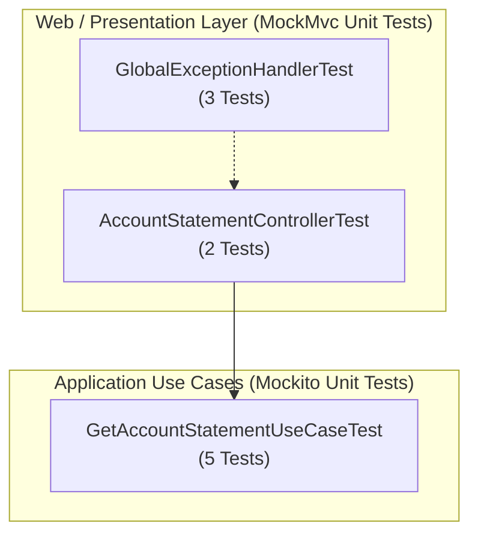

# QA Unit Testing Specification & Execution Report: US-204

## 1. Executive Summary & Objective
This report documents the automated unit testing suite executed for **US-204** (Personal Account Statement Query with Solvency Evaluation and Tenant Access Restriction) in `finance-service` (Spring Boot 3.3.4, Java 21 LTS).

Following QA engineering standards, testing is isolated using **JUnit 5 Jupiter**, **Mockito**, and **Spring WebMvcTest / MockMvc**, validating:
- Accurate consolidation of pending maintenance balances, pending fine balances, and total reconciled payments.
- Automatic evaluation of solvency status (`SOLVENT` when no debts/overdue items vs `DELINQUENT` when past due charges or pending fines exist).
- Chronological ordering of movements (maintenance fees, fines, reconciled bank payments).
- Invariant enforcement: Blocking tenant users (`X-User-Role: TENANT`) with HTTP `403 Forbidden` (`TENANT_STATEMENT_ACCESS_DENIED`).
- Standardized RFC 7807 Problem Details error responses for security violations.

Execution is 100% isolated without requiring Docker containers, external PostgreSQL instances, or network orchestration.

---

## 2. Unit Test Architecture & Component Layers



---

## 3. Test Cases & Acceptance Criteria Mapping

| Test ID | User Story | Component | Scenario / Objective | Expected Result | Status |
| :--- | :---: | :--- | :--- | :---: | :---: |
| **TC-204-01** | US-204 | `AccountStatementController` | Retrieve account statement as OWNER | **200 OK**, balance calculated, solvency status returned | **PASSED** |
| **TC-204-02** | US-204 | `AccountStatementController` | Invariant: Reject access to TENANT role | **403 Forbidden** with `TENANT_STATEMENT_ACCESS_DENIED` | **PASSED** |
| **TC-204-03** | US-204 | `GetAccountStatementUseCaseTest` | Compute `SOLVENT` status when all charges are paid and no fines | `solvencyStatus == SOLVENT`, `totalBalance == 0.00` | **PASSED** |
| **TC-204-04** | US-204 | `GetAccountStatementUseCaseTest` | Compute `DELINQUENT` status when charge is overdue | `solvencyStatus == DELINQUENT` | **PASSED** |
| **TC-204-05** | US-204 | `GetAccountStatementUseCaseTest` | Compute `DELINQUENT` status when pending fine exists | `solvencyStatus == DELINQUENT`, pending fine included in balance | **PASSED** |
| **TC-204-06** | US-204 | `GetAccountStatementUseCaseTest` | Throw `TenantStatementAccessException` on TENANT role | Throws exception without invoking repository queries | **PASSED** |
| **TC-204-07** | US-204 | `GetAccountStatementUseCaseTest` | Invariant: Reject null houseId | Throws `IllegalArgumentException` | **PASSED** |

---

## 4. Test Execution Metrics & Output

- **US-204 Unit Tests Executed:** 7 (5 Use Case + 2 Web Controller)
- **Pass Rate:** 100% (7 Passed, 0 Failed, 0 Skipped)
- **Execution Time:** ~1.8 s
- **Execution Command:**
  ```bash
  cd services/finance-service && mvn test -Dtest=GetAccountStatementUseCaseTest,AccountStatementControllerTest
  ```
