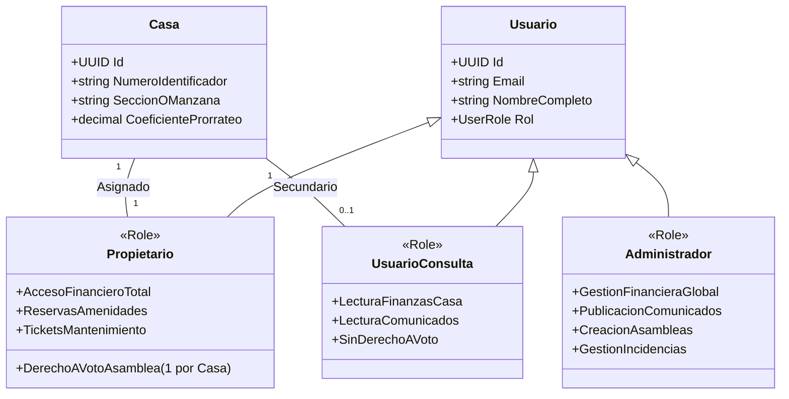

# Documento de Requerimientos Técnicos (TRD) — Sistema de Gestión Residencial

## 1. Visión General & Objetivos del Producto
El **Sistema de Gestión Residencial** es una plataforma integral diseñada para centralizar la administración operativa, financiera y comunitaria de complejos habitacionales (residenciales, condominios, barrios privados). 

El sistema nace preparado arquitectónicamente para un modelo **Multi-Tenant (SaaS)**, pero su implementación y validación inicial de Fase 1 (MVP) estará focalizada en **un cliente residencial específico**.

### 1.1 Objetivos de Negocio
- **Transparencia Financiera:** Proporcionar visibilidad diaria y mensual de ingresos, gastos, facturas y estados financieros a la administración y a los copropietarios.
- **Gestión Comunitaria Eficiente:** Digitalizar la reserva de amenidades y el ciclo de vida de incidencias/mantenimiento.
- **Gobernanza Digital Auditable:** Facilitar la toma de decisiones en asambleas mediante votaciones restringidas con 1 voto por vivienda.
- **Canal de Comunicación Directo:** Publicación centralizada desde Web con recepción push en dispositivos Android.

---

## 2. Definición de Actores y Modelo de Usuario



### 2.1 Reglas de Identidad y Permisos (Invariantes de Dominio)
1. **Unidad Inmobiliaria (Casa):** Es la unidad atómica habitacional.
2. **Propietario (Owner):**
   - **Regla estricta:** Existe **exactamente 1 usuario Propietario por casa**.
   - Posee derechos plenos sobre la vivienda: consulta de saldo y estados de cuenta, reserva de amenidades, apertura de incidencias, y **derecho exclusivo de voto en asambleas**.
3. **Usuario de Consulta (Resident / Family Viewer):**
   - Puede existir **un segundo usuario por casa** con perfil de solo lectura/consulta.
   - Puede visualizar estados de cuenta del inmueble, comunicados y amenidades.
   - **Restricción:** No tiene derecho a emitir votos en asambleas ni realizar modificaciones de titularidad.
4. **Administrador (Admin):**
   - Opera a través de la **Aplicación Web**.
   - Gestiona el catálogo de casas, gastos, facturas, conciliación, comunicados y resolución de tickets.

---

## 3. Alcance de Plataformas y Exclusiones de MVP

### 3.1 Plataformas Objetivo
- **Aplicación Web (Panel Administrativo):**
  - Destinada a administradores, contadores y junta directiva.
  - Gestión de configuración, finanzas densas, reportes, asambleas y emisión de comunicados.
- **Aplicación Móvil (Android):**
  - Destinada a Propietarios y Usuarios de Consulta.
  - Experiencia optimizada para consulta de cuentas, notificaciones push, calendario de amenidades, reporte de tickets y votaciones en asambleas.

### 3.2 Delimitación del Alcance (Scope In vs Scope Out)
| Módulo / Característica | En MVP (Fase 1) | Fuera de Alcance (Fase Futura) | Justificación |
| :--- | :---: | :---: | :--- |
| **Finanzas & Estados Financieros** | **SÍ** | — | Core prioritario del cliente. |
| **Reserva de Áreas Comunes** | **SÍ** | — | Alto valor diario para residentes. |
| **Notificaciones Push (Web -> Android)** | **SÍ** | — | Canal de comunicación oficial. |
| **Asambleas & Votaciones (1 voto/casa)** | **SÍ** | — | Transparencia y gobernanza. |
| **Tickets de Mantenimiento** | **SÍ** | — | Trazabilidad de fallas operativas. |
| **Acceso a Garita / Hardware RFID** | **NO** | **Fase 2** | Se opera actualmente con hardware autónomo. Se desacopla en MVP. |
| **Autenticación con IdP Externo** | **NO** | **Fase 2** | Se inicia con login clásico desacoplado (`IAuthService`), para posterior migración. |
| **Pasarelas de Pago en Línea (Stripe/Card)** | **NO** | **Fase 2** | Fase 1 enfocada en registro de facturas y conciliación administrativa. |

---

## 4. Requerimientos Funcionales Detallados

### RF-01: Autenticación y Desacoplamiento de Seguridad
- **RF-01.1:** Formulario de inicio de sesión estándar (Email/Usuario + Contraseña) con generación de tokens JWT.
- **RF-01.2:** Arquitectura preparada con contrato de interfaz para integración futura con el sistema de seguridad corporativo/externo sin alterar las capas superiores.
- **RF-01.3:** Control de sesiones según rol (`Admin`, `Propietario`, `UsuarioConsulta`).

### RF-02: Gestión Residencial y Asignación de Unidades
- **RF-02.1:** CRUD de Unidades/Casas (número, manzana/calle, coeficiente de copropiedad opcional).
- **RF-02.2:** Vinculación de 1 Propietario por casa.
- **RF-02.3:** Alta/baja del usuario secundario de consulta asociado a la casa.

### RF-03: Módulo Financiero y Contabilidad Diaria
- **RF-03.1: Registro de Facturas y Gastos:**
  - Carga de facturas de proveedores (número de factura, fecha, proveedor, categoría de gasto, descripción, monto, archivo adjunto/PDF/imagen).
  - Categorización contable (Servicios básicos, Mantenimiento preventivo, Seguridad, Limpieza, Imprevistos).
- **RF-03.2: Cuotas de Mantenimiento:**
  - Generación mensual de cobros a las casas (cuota ordinaria fija o por alícuota).
  - Registro de cobros extraordinarios acordados en asambleas.
- **RF-03.3: Estados de Cuenta por Casa:**
  - Histórico de cargos y pagos por vivienda.
  - Indicador de estado de solvencia (Al día / En mora).
- **RF-03.4: Estados Financieros y Reportes Ejecutivos:**
  - Generación de Flujo de Efectivo (Ingresos vs Egresos del mes y acumulado).
  - Reporte de balance general mensual para presentación en asambleas.
  - Exportación a PDF y Excel desde la Web App.

### RF-04: Áreas Comunes y Calendario de Reservas
- **RF-04.1:** Catálogo de amenidades configurables (Casa Club, Kiosco/Parrilla, Canchas deportivas, etc.) con capacidad máxima y franjas horarias permitidas.
- **RF-04.2:** Calendario interactivo en la app Android y panel Web que muestre horarios libres y ocupados en tiempo real.
- **RF-04.3:** Solicitud de apartado por parte del residente:
  - Validación de regla de negocio: ¿Permitir apartar solo a casas al día (solventes)? (Configurable por el admin).
  - Prevenir solapamiento de horarios (detección de conflictos de reserva).
- **RF-04.4:** Panel administrativo de confirmación o cancelación con motivo.

### RF-05: Notificaciones y Comunicados Oficiales
- **RF-05.1:** La administración puede redactar comunicados desde la Web (título, cuerpo, prioridad, adjuntos).
- **RF-05.2:** Disparo automático de notificaciones Push (Firebase Cloud Messaging - FCM) a los dispositivos Android registrados.
- **RF-05.3:** Segmentación de avisos: General (todo el residencial) o Focalizado (por manzana, casa específica o morosos).
- **RF-05.4:** Bandeja persistente de comunicados dentro de la app Android para consulta histórica.

### RF-06: Asambleas y Sistema de Votaciones
- **RF-06.1:** Creación de Asambleas por el Administrador con fecha, hora, orden del día y lista de mociones a votar.
- **RF-06.2: Emisión del Voto (Restricción de Dominio):**
  - **Solo el usuario Propietario** puede emitir el voto.
  - **1 voto por casa:** Si la casa ya votó, el sistema bloquea cualquier intento duplicado.
  - El Usuario de Consulta puede ver la asamblea y los resultados, pero tiene el botón de votación deshabilitado.
- **RF-06.3:** Reporte Oficial de Asamblea:
  - Generación de acta de resultados con quórum alcanzado, total de votos a favor, en contra y abstenciones.
  - Cierre y sellado de la votación (inmutable tras el cierre).

### RF-07: Tickets de Mantenimiento e Incidencias
- **RF-07.1:** Creación de tickets desde la app móvil por Propietario o Usuario de Consulta (título, categoría de daño, ubicación en el residencial, descripción y fotografía).
- **RF-07.2:** Máquina de estados del ticket:
  ```mermaid
  stateDiagram-v2
      [*] --> Abierto : Creado por Residente
      Abierto --> EnRevision : Admin toma el ticket
      EnRevision --> EnProceso : Asignado a técnico
      EnProceso --> Resuelto : Trabajo completado
      Resuelto --> Cerrado : Confirmado por Residente / Admin
      EnRevision --> Rechazado : Fuera de alcance / Inválido
  ```
- **RF-07.3:** Notificaciones push al residente reportante cada vez que el estado del ticket cambie o se agregue un comentario de seguimiento.

---

## 5. Requerimientos No Funcionales (RNF)

1. **Multi-tenancy Ready:**
   - La base de datos y los modelos de dominio incluirán `TenantId` como discriminador lógico desde el día 1, permitiendo migrar a múltiples residenciales sin rediseñar el esquema.
2. **Seguridad y Confidencialidad:**
   - Encriptación de datos en tránsito (HTTPS/TLS) y en reposo.
   - Separación estricta de datos entre casas: un residente nunca podrá visualizar el estado de cuenta ni los tickets privados de otra casa.
3. **Disponibilidad y Concurrencia:**
   - En momentos de asambleas y votaciones, el sistema debe soportar picos de concurrencia donde todos los propietarios votan en ventanas de 5 a 10 minutos sin inconsistencias de concurrencia (bloqueos optimistas en la emisión de votos).
4. **Usabilidad y Rendimiento Móvil:**
   - Aplicación Android reactiva con tiempos de respuesta en API menores a 300ms en operaciones de lectura.
   - Soporte de almacenamiento en caché para consulta de datos estáticos y comunicados sin conexión momentánea.

---

## 6. Matriz de Trazabilidad de Roles vs Módulos

| Módulo / Funcionalidad | Administrador (Web) | Propietario (Android) | Usuario Consulta (Android) |
| :--- | :---: | :---: | :---: |
| **Ingreso al Sistema** | ✅ | ✅ | ✅ |
| **Gestión de Casas y Asignaciones** | ✅ (CRUD) | ❌ | ❌ |
| **Registro de Facturas y Gastos** | ✅ (CRUD) | ❌ | ❌ |
| **Ver Estados Financieros Globales** | ✅ | ✅ (Resumen público) | ✅ (Resumen público) |
| **Ver Estado de Cuenta Propio** | ✅ (Todas las casas) | ✅ (Su casa) | ✅ (Su casa) |
| **Reservar Áreas Comunes** | ✅ (Gestiona y aprueba) | ✅ (Solicita y cancela) | ❌ (Solo ver calendario) |
| **Publicar Comunicados** | ✅ (Emite y envía Push) | ❌ | ❌ |
| **Recibir Notificaciones Push** | ❌ (Panel emisor) | ✅ | ✅ |
| **Votar en Asambleas** | ❌ (Modera y abre/cierra) | ✅ (1 voto por casa) | ❌ (Solo lectura) |
| **Ver Resultados de Asambleas** | ✅ (Reporte oficial) | ✅ | ✅ |
| **Crear Tickets de Incidencias** | ✅ | ✅ | ✅ |
| **Actualizar Estado de Tickets** | ✅ | ❌ | ❌ |

---

## 7. Preguntas y Decisiones Abiertas para la Fase de Arquitectura
1. **Regla de Solvencia:** ¿Deseas que un propietario que esté en mora (deuda pendiente de cuotas) quede bloqueado automáticamente para:
   - ¿Reservar áreas comunes?
   - ¿Votar en asambleas? (En muchas legislaciones de propiedad horizontal, solo votan quienes están al día).
2. **Método de Cómputo de Votos en Asambleas:**
   - ¿Cada casa representa **1 voto idéntico**, o el voto tiene un peso porcentual según el **coeficiente de copropiedad (m²)** de la casa?
3. **Flujo de Pagos:**
   - Cuando el residente paga la cuota de mantenimiento, ¿va a subir la foto/comprobante de transferencia desde la app móvil para que el administrador la apruebe en la Web? (Esto agiliza mucho el trabajo contable).
