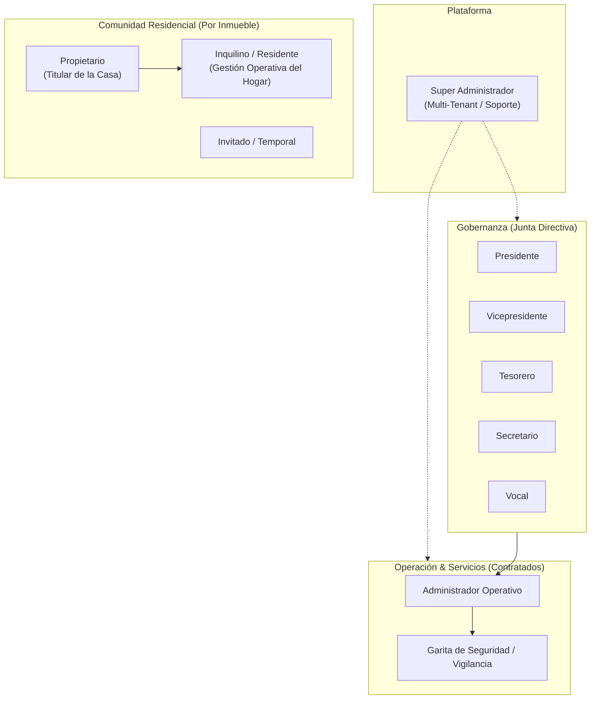
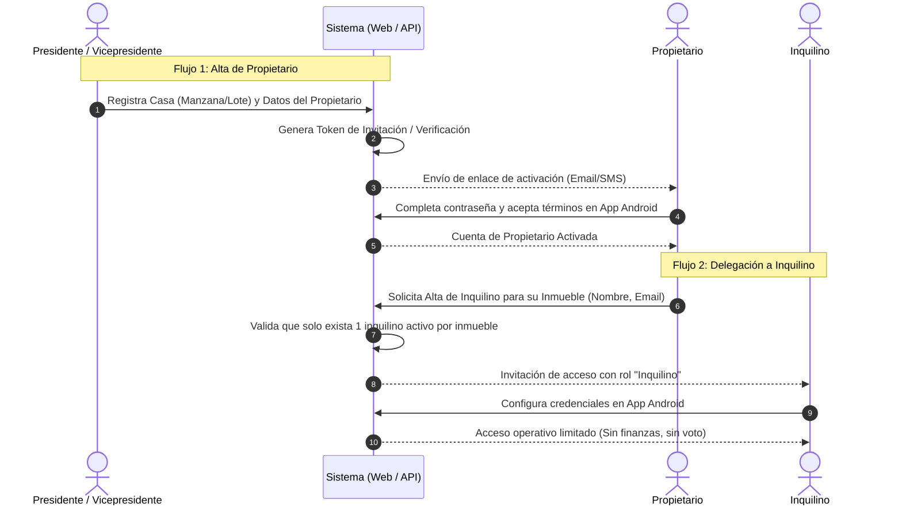

# Especificación del Modelo de Identidad, Roles y Onboarding — Sistema de Gestión Residencial

## 1. Jerarquía y Taxonomía de Usuarios (RBAC)

El sistema clasifica a los usuarios en cuatro grandes dominios funcionales: **Plataforma (Gobierno Global)**, **Gobernanza Residencial (Junta Directiva)**, **Operación Administrativa/Servicios** y **Comunidad Residencial (Inmueble)**.

---

## 2. Definición Detallada de Roles y Matriz de Permisos

### 2.1 Plataforma & Gobernanza
* **Super Administrador:**
  - Control de plataforma a nivel infraestructura/tenancy.
  - Creación y configuración de nuevos residenciales (preparación SaaS/Multi-tenant).
  - Gestión de parámetros globales y soporte de segundo nivel.
* **Presidente & Vicepresidente:**
  - Visibilidad y capacidad de modificación **total** sobre las operaciones diarias del residencial.
  - Aprobación de estados financieros, presupuestos, contratos y ejecución de gastos.
  - Creación y validación de usuarios residenciales (Onboarding formal).
  - Apertura, moderación y sellado de Asambleas Generales y votaciones.
* **Tesorero:**
  - Gestión directa del módulo financiero: revisión de facturas, conciliación de pagos de cuotas, generación de balances y estados financieros.
  - Acceso de lectura al módulo de incidencias y áreas comunes cuando impliquen costos.
* **Secretario:**
  - Redacción y publicación de comunicados oficiales y actas de asambleas.
  - Registro de quórum y documentación legal de las votaciones.
* **Vocal:**
  - Supervisión de tickets de incidencias, amenidades y apoyo general en la gestión comunitaria con permisos orientados a seguimiento.

### 2.2 Operación Externa (Personal Contratado)
* **Administrador Operativo:**
  - Profesional o empresa externa contratada para la gestión diaria.
  - Registra facturas y gastos, gestiona proveedores, coordina tickets de mantenimiento y prepara reportes para la Junta Directiva.
  - No vota en asambleas (no es propietario).
* **Garita de Seguridad:**
  - Rol operativo de vigilancia (futuro módulo de accesos/visitas y paquetería).
  - En la fase actual: consulta de directorio de casas para emergencias o recepción de incidencias operativas. Sin acceso a finanzas ni estados de cuenta.

### 2.3 Comunidad Residencial (Por Inmueble / Casa)
* **Propietario (Owner):**
  - Titular legítimo de la casa (**exactamente 1 por inmueble**).
  - Identificado obligatoriamente por su documento de identidad: CUI/DPI (13 dígitos con validación por algoritmo Módulo 11) o Pasaporte válido si es extranjero.
  - **Financiero:** Visualización y descarga de estados de cuenta de su casa, recepción de notificaciones de cobro, subida de comprobantes de pago.
  - **Gobernanza:** Derecho exclusivo de emisión de voto en asambleas (1 voto por casa).
  - **Gestión:** Creación y gestión del usuario Inquilino de su propiedad.
* **Inquilino (Tenant / Residente):**
  - Usuario que habita la vivienda bajo arrendamiento.
  - **Permitido:** Reservar áreas comunes, reportar tickets de mantenimiento, recibir comunicados de convivencia y avisos operativos (ej. corte de agua o mantenimiento de bombas).
  - **Restringido:** **No ve estados de cuenta, ni cobros de cuotas de mantenimiento, ni tiene derecho a voto en asambleas**.
* **Invitado (Guest):**
  - Usuario de acceso temporal o restringido (para futuras reservas puntuales o pases).

---

## 3. Matriz Comparativa de Capacidades por Rol

| Módulo / Acción | SuperAdmin | Pte / Vice | Tesorero | Sec / Vocal | Admin Op | Garita | Propietario | Inquilino |
| :--- | :---: | :---: | :---: | :---: | :---: | :---: | :---: | :---: |
| **Configuración Residencial** | ✅ | ✅ | ❌ | ❌ | Lectura | ❌ | ❌ | ❌ |
| **Onboarding / Aprobar Propietarios** | ✅ | ✅ | ❌ | ❌ | ❌ | ❌ | ❌ | ❌ |
| **Crear Inquilino (su casa)** | ❌ | ❌ | ❌ | ❌ | ❌ | ❌ | ✅ | ❌ |
| **Ver Finanzas Globales / Balances** | ✅ | ✅ | ✅ | Lectura | ✅ | ❌ | Resumen Púb. | ❌ |
| **Registrar Facturas y Gastos** | ✅ | ✅ | ✅ | ❌ | ✅ | ❌ | ❌ | ❌ |
| **Ver Estado de Cuenta de Casa** | ✅ | ✅ | ✅ | ❌ | ✅ | ❌ | ✅ (Su casa) | ❌ |
| **Alertas de Cobro / Deuda** | ❌ | ❌ | ❌ | ❌ | ❌ | ❌ | ✅ | ❌ |
| **Avisos Operativos / Convivencia** | ✅ | ✅ | ❌ | ✅ | ✅ | ❌ | ✅ | ✅ |
| **Reservar Áreas Comunes** | ❌ | ✅ | ❌ | ❌ | Modera | ❌ | ✅ | ✅ |
| **Crear Tickets de Mantenimiento** | ❌ | ✅ | ❌ | ✅ | ✅ | ✅ | ✅ | ✅ |
| **Votar en Asambleas (1 por Casa)** | ❌ | ✅* | ❌ | ❌ | ❌ | ❌ | ✅ | ❌ |

*\*Nota: Miembros de Junta Directiva solo votan si participan en calidad de Propietarios de su respectivo inmueble.*

---

## 4. Flujo de Onboarding y Creación de Usuarios

Para garantizar la seguridad jurídica y patrimonial, **no existe el auto-registro abierto**.

---

## 5. Estándar de Auditoría Inmutable

Dado el requerimiento de trazabilidad estricta:
1. **Entidades Auditables (`IAuditableEntity`):**
   - Todas las entidades del dominio deben registrar:
     - `CreatedAtUtc`
     - `CreatedByUserId`
     - `LastModifiedAtUtc`
     - `LastModifiedByUserId`
2. **Bitácora de Auditoría de Cambios Críticos (`AuditLog`):**
   - Cambios de titularidad de casas, modificación de facturas/gastos, cancelaciones de reservas, votos y cambios de estado de tickets deben persistir:
     - `EntityName`, `EntityId`, `Action` (Insert, Update, Delete)
     - `OldValues` (JSON), `NewValues` (JSON)
     - `IpAddress`, `UserAgent`, `TenantId`
