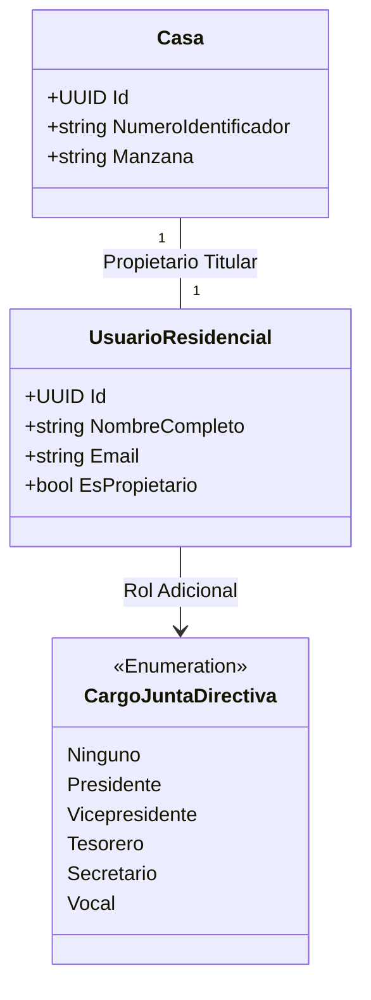
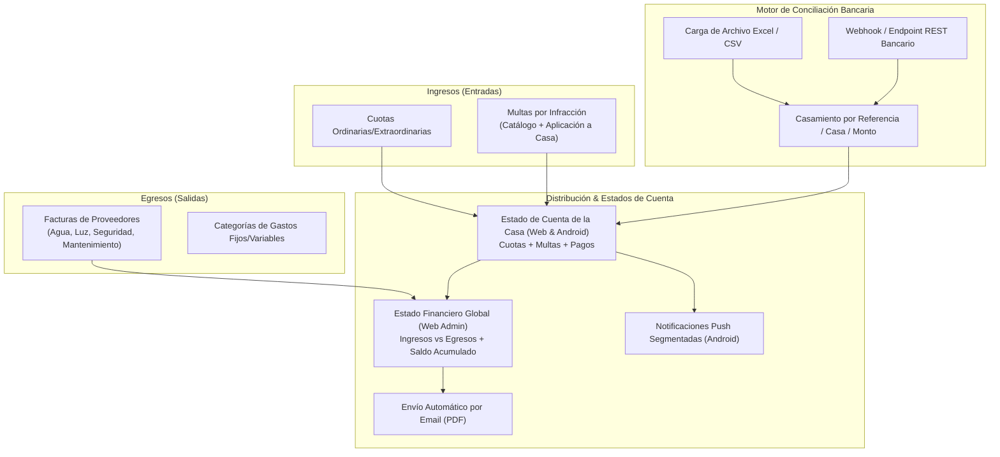
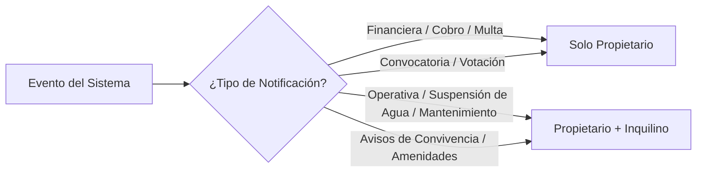

# Especificación Técnica: Módulo Financiero, Flujo de Caja y Gestión de Activos

## 1. Visión y Enfoque Pragmático
El módulo financiero está orientado a un esquema de **Caja / Ingresos y Egresos Operativos** (sin sobrecargar el sistema con cuentas contables complejas de partida doble), buscando máxima claridad y transparencia para la administración y los residentes:
1. **Salidas (Egresos):** Facturas de gastos fijos (seguridad, energía eléctrica, agua, áreas verdes, etc.) y gastos extraordinarios.
2. **Entradas (Ingresos):** Cuotas de mantenimiento y cobro de multas aplicadas a las casas.
3. **Conciliación de Cobranza:** Carga masiva (vía Excel/CSV) y/o Endpoint REST para sincronización bancaria.
4. **Control de Activos:** Inventario de mobiliario y equipo del residencial.
5. **Transparencia y Distribución:** Generación mensual, envío por correo electrónico y notificación push segmentada a la App Android.

---

## 2. Ajuste del Modelo de Identidad (Junta Directiva como Rol de Propietario)

> **Invariante de Dominio:** Ningún miembro de la Junta Directiva puede ser un agente externo. Para ostentar un cargo de Junta Directiva, el usuario debe ser obligatoriamente un **Propietario** asignado a una vivienda.

---

## 3. Arquitectura del Módulo Financiero

---

## 4. Requerimientos Funcionales Específicos

### 4.1 Egresos: Registro de Facturas y Proveedores
- **Catálogo de Categorías de Gastos:** Seguridad privada, Alumbrado público/Energía eléctrica, Agua potable, Mantenimiento de bombas/portones, Jardinería, Suministros de limpieza, Imprevistos.
- **Registro de Factura:**
  - Número de factura / serie.
  - Proveedor (Nombre, Identificador fiscal/NIT/RFC).
  - Fecha de emisión y fecha de pago.
  - Monto total.
  - Soporte digital adjunto (PDF o imagen de la factura física).
  - Campos de auditoría obligatorios (`CreatedBy`, `CreatedAt`).

### 4.2 Ingresos: Cuotas de Mantenimiento y Conciliación Bancaria
El residencial no cobra directamente en caja; el cobro lo recauda un banco o servicio externo que entrega periódicamente la bitácora de transacciones.
- **Carga de Archivo (Excel/CSV):**
  - Módulo en la Web para subir el estado de cuenta provisto por el banco.
  - Parser resiliente que valida: Identificador de Casa/Referencia, Fecha de Operación, Monto y Número de Autorización bancaria.
  - Detección automática de duplicados por clave única (`NumeroAutorizacionBancaria`).
- **Endpoint API (Integración Directa):**
  - Endpoint seguro autenticado (`/api/v1/finance/bank-transactions`) para ingesta automática de transacciones si el banco o un worker automatizado despacha webhooks.
- **Conciliación y Acreditación:**
  - Acreditación automática al estado de cuenta de la casa correspondiente.
  - Alertas de discrepancia (ej. depósitos con identificador no reconocido o montos incompletos).

### 4.3 Sistema Configurable de Multas
- **Catálogo de Multas:**
  - Definición de tipos de infracción (ej. Exceso de velocidad, Ruidos molestos fuera de horario, Mal uso de áreas comunes, Basura en vía pública, Mascotas sin correa).
  - Monto predeterminado o rango sancionatorio configurable por la Junta Directiva.
- **Aplicación de Multa a Casa:**
  - El Administrador/Junta aplica la sanción a la Casa vinculada con evidencia (descripción, fecha/hora del incidente, fotografía opcional).
  - La multa se refleja de inmediato en el balance de la casa como saldo pendiente.
  - Disparo de notificación push inmediata al Propietario.

### 4.4 Control de Mobiliario y Equipo (Activos Fijos)
Módulo operativo para llevar la bitácora del patrimonio del residencial:
- **Campos del Activo:**
  - Código/Placa de inventario.
  - Nombre del bien (ej. Generador eléctrico, Cortacésped, Mobiliario de Casa Club, Bombas de agua).
  - Ubicación física (Garita, Casa Club, Pozo, etc.).
  - Fecha de adquisición, costo original y factura vinculada.
  - Estado operativo: `Excelente`, `Bueno`, `Requiere Mantenimiento`, `De Baja / Dañado`.
  - Historial de mantenimientos preventivos/correctivos asociados.

---

## 5. Visualización, Reportes y Segmentación por Canal

### 5.1 Niveles de Visibilidad Financiera
| Vista / Documento | Web (Admin / Junta) | Web (Propietario) | Android (Propietario) | Android (Inquilino) |
| :--- | :---: | :---: | :---: | :---: |
| **Flujo Global Residencial (Ingresos vs Egresos)** | ✅ Completo | ✅ Resumen Público | ❌ No disponible | ❌ No disponible |
| **Detalle de Facturas de Proveedores** | ✅ Con soportes | ✅ Lista resumida | ❌ No disponible | ❌ No disponible |
| **Estado de Cuenta de la Casa (Cuotas + Multas)** | ✅ Todas las casas | ✅ Su casa | ✅ Su casa | ❌ Bloqueado |
| **Detalle de Multas Aplicadas** | ✅ Todas | ✅ Su casa | ✅ Su casa | ❌ Bloqueado |
| **Inventario de Mobiliario y Equipo** | ✅ Edición total | ✅ Lectura general | ❌ No disponible | ❌ No disponible |

### 5.2 Notificaciones Push Segmentadas en Android
El motor de notificaciones debe clasificar estrictamente el destinatario para no alertar al inquilino de temas patrimoniales/financieros:

- **Notificaciones al Propietario:**
  - "Se ha generado la cuota de mantenimiento del mes de [Mes]."
  - "Se ha registrado una multa por [Motivo] aplicada a su inmueble."
  - "Su pago bancario de [Monto] ha sido conciliado exitosamente."
  - "Se ha emitido el Estado de Cuenta mensual. Disponible en su correo y aplicación."
- **Notificaciones al Inquilino (Sin datos de dinero ni cobro):**
  - "Aviso de mantenimiento: Se suspenderá el servicio de agua potable mañana de 08:00 a 12:00."
  - "Recordatorio: Convivencia y horarios de ruido para este fin de semana."

---

## 6. Cierre Mensual y Distribución de Estados de Cuenta
1. **Generación Programada:** El primer día de cada mes (o fecha configurable), un proceso en background genera los consolidados mensuales.
2. **Generación de PDF:** Estado de cuenta individual por casa con:
   - Saldo anterior.
   - Cargos del mes (cuota de mantenimiento + multas aplicadas).
   - Abonos y pagos conciliados del banco.
   - Saldo final (Al día / Saldo pendiente).
3. **Distribución Multicanal:**
   - Despacho del PDF adjunto al correo electrónico registrado del Propietario.
   - Envío de notificación Push al dispositivo Android indicando la disponibilidad del estado de cuenta.
