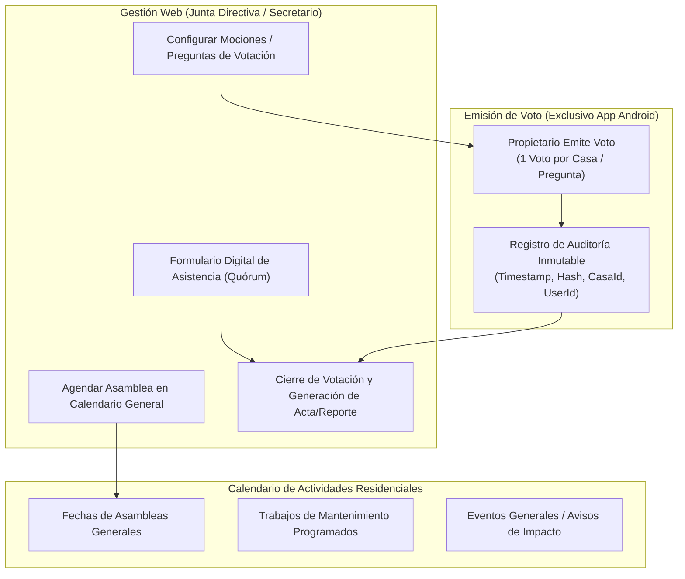
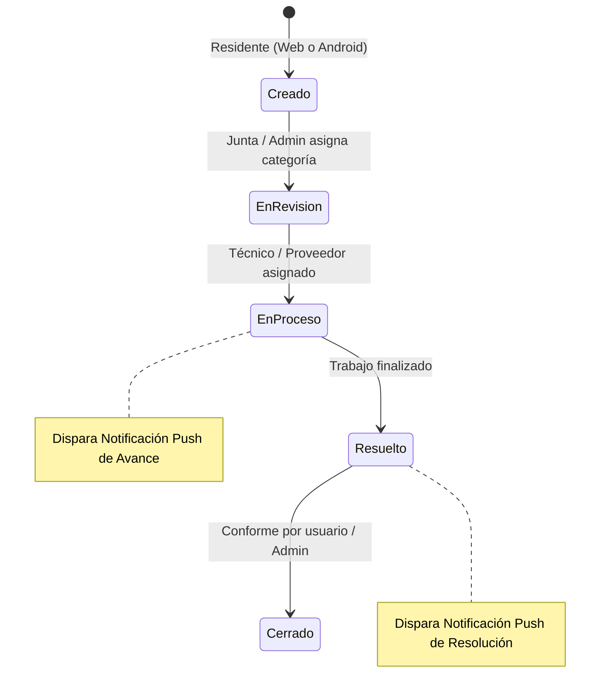

# Especificación Técnica: Áreas Comunes, Asambleas, Votaciones y Tickets de Mantenimiento

## 1. Módulo de Áreas Comunes y Reservas

### 1.1 Reglas de Negocio y Configuración (Junta Directiva)
* **Gestión de Amenidades:**
  - Catálogo de áreas comunes (ej. Casa Club, Pérgola/Parrilla, Piscina, Canchas de fútbol/pádel, Salón de eventos).
  - Configuración de **horarios permitidos de uso y reserva** (ej. Casa Club disponible de 10:00 a 22:00 en bloques o día completo).
  - Configuración de **costo de reserva/alquiler**: Monto específico por amenidad o por franja horaria.
* **Catálogo Configurable de Tipos de Eventos:**
  - Lista administrable exclusivamente por la Junta Directiva (ej. *Cumpleaños, Boda/Aniversario, Convivio Familiar, Reunión Infantil, Evento Deportivo, Sesión de Trabajo*).
* **Regla de Solvencia (Mora):**
  - Motor de validación: Antes de confirmar la reserva, el sistema verifica que la casa solicitante no tenga cuotas de mantenimiento o multas vencidas. (Parámetro configurable por la Junta Directiva para activar/desactivar o fijar tolerancia).

### 1.2 Privacidad y Visualización del Calendario (Web & Android)
* **Calendario Público para Residentes:**
  - Accesible tanto en la Web como en la App Android.
  - Muestra bloques como **Disponible** u **Ocupado**.
  - **Invariante de Privacidad:** Jamás expone públicamente el nombre del residente, el número de casa ni el tipo de evento que reservó. Solo se indica "Reservado".
* **Impacto Financiero Inmediato:**
  - Al confirmarse el apartado, el costo de la reserva se **carga automáticamente al Estado de Cuenta de la casa** como un concepto de "Alquiler de Área Común".
  - Disparo de notificación Push a la App Android del solicitante: *"Tu reserva para [Área Común] el día [Fecha] ha sido confirmada. Se ha cargado el monto de [Q/USD X] a tu estado de cuenta."*

---

## 2. Calendario de Actividades, Asambleas y Votaciones

### 2.1 Calendario General de Actividades
* Unificado y visible para todos los Propietarios e Inquilinos (Web y Android).
* Contiene:
  - Convocatorias de Asambleas Ordinarias y Extraordinarias.
  - Trabajos de mantenimiento programado (ej. Lavado de cisternas, poda general, fumigación).
  - Eventos comunitarios o alertas generales.

### 2.2 Control de Asistencia y Quórum (Web)
* **Formulario Único de Asistencia:**
  - Accesible por el Secretario o miembros de la Junta Directiva desde la Web.
  - Lista de todas las casas del residencial para marcar: *Presente (Propietario)*, *Representado por Carta Poder*, o *Ausente*.
  - Cálculo de quórum en tiempo real (% de casas presentes).
  - Exportación de **Reporte Oficial de Asistencia (PDF)** firmado digitalmente.

### 2.3 Sistema de Votaciones (Exclusivo App Android)
* **Restricción de Plataforma:** Las votaciones se ejecutan **únicamente a través de la Aplicación Móvil Android**.
* **Invariante de Dominio (1 Voto por Casa):**
  - Cada casa tiene derecho a emitir **un solo voto por pregunta/moción**.
  - Si el Propietario vota, el sistema bloquea inmediatamente la pregunta para esa vivienda.
  - Los usuarios Inquilinos tienen el módulo de votación bloqueado.
* **Seguridad y Auditoría:**
  - Cada voto emitido registra: `AsambleaId`, `PreguntaId`, `CasaId`, `UserId`, `FechaHoraUtc`, `IpDispositivo`.
* **Cierre y Reporte Oficial:**
  - El Secretario/Presidente cierra la votación desde la Web.
  - Generación automática del **Reporte Oficial de Votaciones (PDF)**: desglose de votos emitidos (A Favor, En Contra, Abstención), quórum participante y veredicto de aprobación.

---

## 3. Módulo de Tickets de Mantenimiento e Incidencias

### 3.1 Creación y Omnicanalidad
* Disponibilidad tanto en la **Aplicación Web** como en la **Aplicación Móvil Android**.
* Roles permitidos para reportar: Propietarios, Inquilinos y Garita de Seguridad.
* Campos del Ticket:
  - Título y Descripción detallada del problema.
  - Categoría de mantenimiento (configurable por la Junta: ej. *Alumbrado Público, Fuga de Agua, Asfalto/Calles, Jardinería, Portón de Garita, Ruido/Vecinos*).
  - Ubicación específica (ej. Calle 3 frente a Casa 45, Parque infantil).
  - Adjuntos multimedia (fotografías tomadas desde la app o cargadas en web).

### 3.2 Seguimiento, Avances y Notificaciones
* El Administrador o Vocal de la Junta actualiza el avance y asigna notas técnicas.
* **Notificaciones Push Automáticas:**
  - Notificación al creador ante **cada cambio de estado** (ej. "Tu reporte #104 ha pasado a: En Proceso").
  - Notificación de **Avance**: cuando el administrador agrega un comentario de seguimiento.
  - Notificación de **Cierre**: cuando la incidencia ha sido resuelta con evidencia final.

---

## 4. Matriz de Plataforma y Permisos por Módulo

| Módulo / Acción | Web (Junta Directiva) | Web (Propietario / Inquilino) | Android (Propietario) | Android (Inquilino) |
| :--- | :---: | :---: | :---: | :---: |
| **Configurar Horarios y Precios Amenidades** | ✅ Exclusivo | ❌ | ❌ | ❌ |
| **Ver Calendario de Amenidades (Sin nombres)** | ✅ | ✅ | ✅ | ✅ |
| **Apartar Área Común (Con cobro a cuenta)** | ✅ (Por terceros) | ✅ | ✅ | ✅ (Si solvente) |
| **Ver Calendario de Actividades / Asambleas** | ✅ | ✅ | ✅ | ✅ |
| **Pase de Lista / Asistencia a Asambleas** | ✅ Exclusivo | ❌ | ❌ | ❌ |
| **Emitir Voto en Asambleas (1 por Casa)** | ❌ | ❌ | ✅ Exclusivo | ❌ Bloqueado |
| **Descargar Reportes de Votación / Asistencia** | ✅ | ✅ | ✅ | ❌ |
| **Crear Tickets de Mantenimiento** | ✅ | ✅ | ✅ | ✅ |
| **Actualizar Avances / Cerrar Tickets** | ✅ Exclusivo | ❌ | ❌ | ❌ |
| **Recibir Push de Avance de Tickets** | ❌ (Panel web) | ❌ | ✅ | ✅ |
