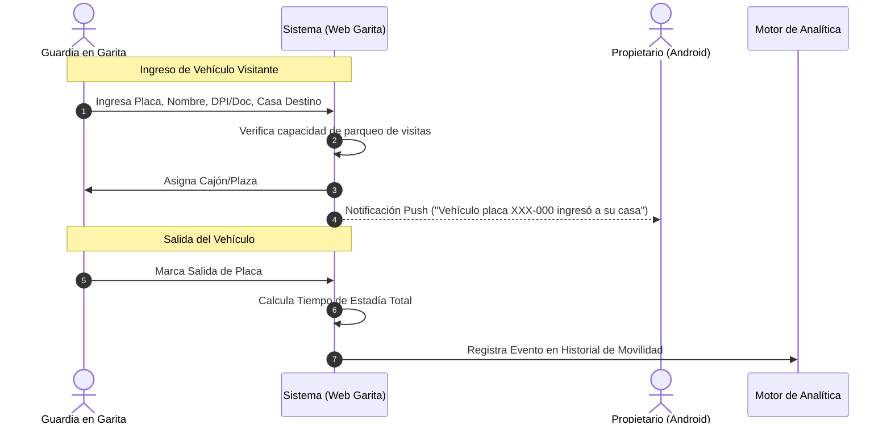
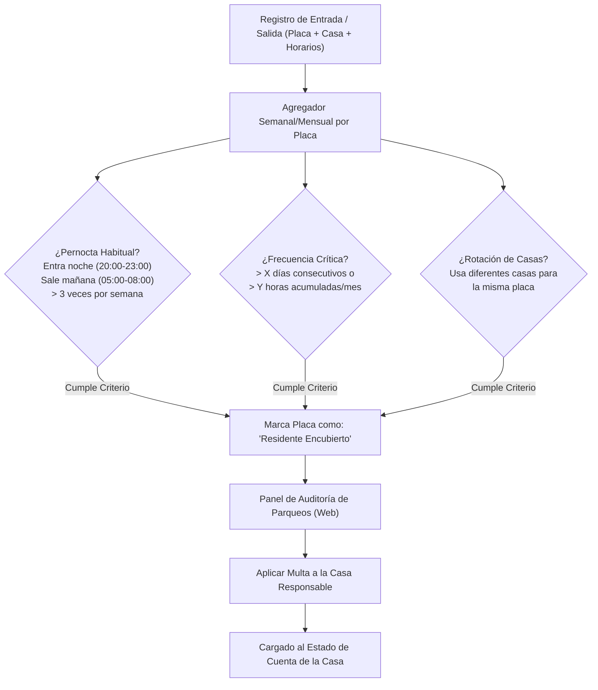

# Especificación Técnica: Módulo de Parqueo de Visitas y Detección de Patrones de Uso Indebido

## 1. Visión y Problemática de Negocio

### 1.1 El Problema Operativo
1. Cada casa tiene un cupo estrictamente limitado de accesos vehiculares directos (ej. 2 tarjetas RFID asignadas a sus estacionamientos privados).
2. Cuando una vivienda posee un tercer o cuarto vehículo (o alquila habitaciones sin declarar), los residentes tienden a evadir el control ingresando por el carril de visitas y ocupando los **parqueos comunes de visitantes** durante toda la noche de manera recurrente.
3. Esto satura el parqueo común, priva a los visitantes reales de espacio y desgasta la convivencia sin retribución a la administración.

### 1.2 La Solución del Sistema
* **Registro Rápido en Garita:** Formulario web optimizado para la tablet de seguridad/garita al momento del ingreso.
* **Control de Cupos y Asignación:** Asignación de un número de cajón/plaza de parqueo de visitas disponible.
* **Motor Heurístico de Detección de Patrones (Fraud Detection):** Análisis algorítmico de frecuencia, horarios y pernoctas que clasifica a un vehículo como *Visita Frecuente Sospechosa / Residente Encubierto*.
* **Generación de Alertas y Multas Automáticas:** Notificación a la administración y aplicación directa de la multa al estado de cuenta de la casa vinculada.

---

## 2. Flujo Operativo de Registro en Garita

### 2.1 Datos Registrados en el Formulario de Garita
* **Placa del Vehículo:** Clave principal de seguimiento histórico (normalizada en mayúsculas sin espacios/guiones).
* **Casa Destino:** Número y manzana que visita.
* **Nombre del Conductor & Documento de Identificación (DPI/Cédula/Licencia).**
* **Fecha y Hora de Entrada:** Automático (Timestamp de servidor).
* **Plaza de Parqueo Asignada:** Número de cajón de visita temporal.
* **Fecha y Hora de Salida:** Registrada al retirarse el vehículo.

---

## 3. Motor Heurístico de Detección de Comportamiento Anómalo

### 3.1 Criterios de Clasificación de Vehículos
El motor evalúa periódicamente (o en tiempo real al registrar entrada) las siguientes reglas configurables por la Junta Directiva:

1. **Patrón de Pernocta (Sleep & Commute):**
   - Si una misma placa ingresa entre las 19:00 y 23:00 hrs y egresa entre las 05:00 y 09:00 hrs más de **3 veces en una ventana de 7 días**.
   - *Diagnóstico del sistema:* Alta probabilidad de vehículo de residente/inquilino sin tarjeta asignada.
2. **Abuso de Tiempo Acumulado:**
   - La placa supera un umbral configurable (ej. más de 40 horas semanales en parqueo de visitas).
3. **Mapeo de Comportamiento (Heatmap & Timeline):**
   - En la Web de administración se genera un reporte visual:
     - Gráfico de horas de entrada y salida por día de la semana.
     - Historial de todas las casas que ha visitado esa placa.
     - Días totales de pernocta en el mes.

---

## 4. Gestión de Multas por Uso Indebido de Parqueo

### 4.1 Proceso de Sanción
* **Pre-alerta a la Casa:** Al detectar el segundo día consecutivo de pernocta, el sistema puede disparar una notificación de advertencia al Propietario:
  > *"Aviso: El vehículo placa [XYZ-123] asociado a su vivienda ha permanecido en parqueo de visitas en horario nocturno. Recuerde que el parqueo de visitas es de uso temporal."*
* **Emisión de Multa:**
  - Si se confirma la infracción (automáticamente por regla o validado por el Administrador en un clic con la bitácora exportada en PDF como prueba irrefutable):
  - Se genera la sanción según el catálogo de multas (ej. *"Uso indebido y pernocta en parqueo de visitas"*).
  - El monto se carga **inmediatamente al Estado de Cuenta de la casa asociada**.
  - Notificación Push formal de multa emitida al Propietario.

---

## 5. Matriz de Visualización del Módulo de Parqueo

| Funcionalidad / Pantalla | Garita (Tablet) | Junta Directiva / Admin (Web) | Propietario (Android) | Inquilino (Android) |
| :--- | :---: | :---: | :---: | :---: |
| **Formulario Rápido de Registro (In/Out)** | ✅ Optimizado | ✅ | ❌ | ❌ |
| **Monitoreo de Plazas Ocupadas / Libres** | ✅ Tiempo real | ✅ | ❌ | ❌ |
| **Mapa de Calor y Analítica de Placas** | ❌ | ✅ Completo | ❌ | ❌ |
| **Notificación de Visita en su Casa** | ❌ | ❌ | ✅ Notificación Push | ✅ Notificación Push |
| **Historial de Visitas de su Inmueble** | ❌ | ✅ Todas las casas | ✅ Solo su casa | ❌ |
| **Aplicar Multa por Uso Indebido** | ❌ (Solo reporta) | ✅ Aplica y cobra | ❌ | ❌ |
